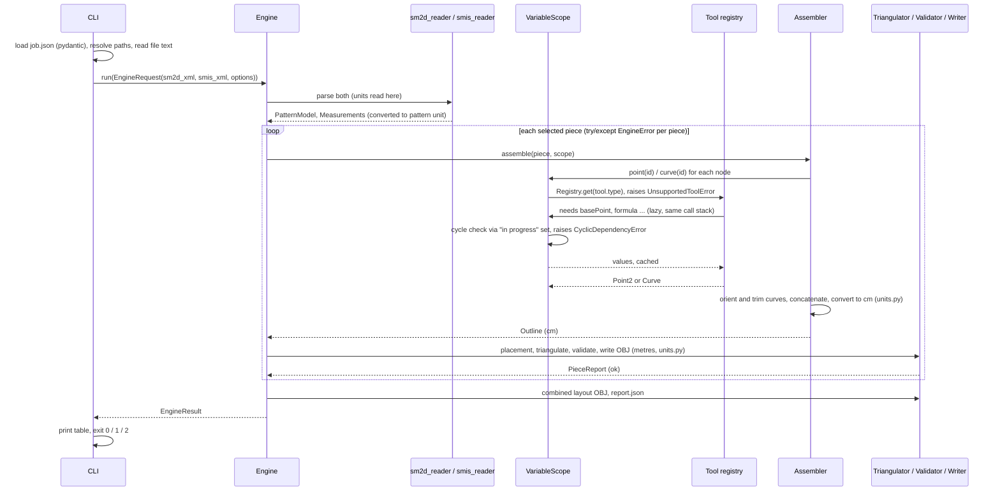

# sm2d-engine: Low-Level Design

Input: Seamly2D pattern (`.sm2d`) plus individual measurements (`.smis`). Output: one real-scale mesh per piece (1 OBJ unit = 1 m), plus `report.json`.

## 0. Findings from reading the reference and the three patterns

| Pattern | Pieces | Tools beyond the prototype's coverage |
|---|---|---|
| `male_shirt` | 17 | none. Prototype tools are enough (`endLine alongLine normal height lineIntersectAxis curveIntersectAxis shoulder cutSpline`, splines, `pathInteractive`). |
| `trousers` | 11 | `lineIntersect`, `cutSplinePath`, `cubicBezier` (simple), `intersectXY`, and **`rotation` operations**. |
| Aldrich skirt (pieces `A - Skirt Back/Front` only, in a 7-piece file) | 2 of 7 | `cubicBezierPath`, `intersectXY`; the skirt tool set is a subset of the prototype's. Other Aldrich pieces use `bisector`, `trueDarts`, `pointOfContact`, `flippingByLine`, `NodeArc` and may fail per piece. |

Findings the spec did not anticipate:

1. **`rotation` operation** (trousers: `Back`, `Front_Pleats`). Operations live in `<calculation>` as `<operation type="rotation" center=… angle=…>` with `<source>` and `<destination>` id lists. The destination objects are **not stored as elements**. They are created from the source objects, paired by position. Pieces refer to them through `modeling` entries whose `idObject` is a destination id. Operations chain (`a3` rotates destinations of `a2`). The reference does not support this, so `Back` and `Front_Pleats` need a new `RotationOp`. It rotates points around `center` by `angle`, with Qt's y-down sense, and rebuilds the curves from the rotated control points. Rotated objects get their id from `destination`, and their name is the source name plus `suffix`. This is a new tool family (`tools/operations/`). If it proves unreliable, those two pieces fail with a clear error, and the other pieces are unaffected.
2. **Angle formulas use `3.14` as pi** (`180/3.14*atan(...)`). This is evaluated literally, as Seamly does. We do not "fix" it.
3. **Units.** Seamly evaluates formulas in *pattern* units: literal numbers in formulas, `single` x/y and `Line_*` are all in the `.sm2d` unit. Measurements are converted from the `.smis` unit into the pattern unit when read. It is impossible to rewrite literals inside formulas into cm without changing the meaning of dimensionless parts such as angles. The design is therefore:
   - `.smis` values are converted to **pattern unit** at the scope boundary.
   - All evaluation runs in the pattern unit.
   - `units.py` converts the finished outlines to **cm**, the canonical unit used for reporting and layout, exactly once, in `assembler`.
   - `units.py` converts cm to m exactly once, at mesh build time.

   For cm patterns this is identical to "evaluate in cm". For the mm jackets it is the only correct behaviour. This is a minor deviation from "convert internally to cm" and is listed again in the final report.
4. **Jackets:** these are multisize patterns, and the measurements they reference are not in any `.smis` we have. The first measurement lookup raises `MissingMeasurementError(name)`, and the piece is reported as failed. Unknown tools raise `UnsupportedToolError(tool_type, piece)`.
5. **Draft blocks:** the Aldrich file has several `<draftBlock>` elements, and calculation objects are nested in them. The reader flattens all of them into one id table, as the prototype does with `root.iter()`.
6. **Arc length and flattening use two different samplers.** Formulas (`Spl_*`, `cutSpline`) use a very dense or Gauss-adaptive length, with error < 0.001 mm. Meshes use adaptive flattening at 0.1 mm max chord deviation. Curve extrema (x and y derivative roots) are forced vertices, so that the flattened bbox equals the true bbox and the ±0.01 cm size tests are not at the mercy of the chord tolerance.

## 1. Dependency rule

```
cli ─▶ engine ─▶ pieces ─▶ tools ─▶ eval ─▶ model
                  │          │        └────▶ geometry
                  └▶ mesh    └─────────────▶ geometry
io ─▶ model        everything ─▶ errors, units
```

Edges only point downward. `io` produces `model` objects and does no maths. `tools` and `eval` hold all the maths.

## 2. Class diagram

```mermaid
classDiagram
    class CLI {
      +main(argv) int
      -load_job(path) JobSpec
      -read_inputs(JobSpec) EngineRequest
      -print_summary(EngineResult)
    }
    class JobSpec { <<pydantic, extra=forbid>> sm2d; smis; output_dir; pieces; format; combined_layout; layout_gap_cm; mirror_fold_pieces }
    class EngineRequest { <<frozen>> sm2d_xml: str; smis_xml: str; options: EngineOptions; sm2d_name; smis_name }
    class EngineOptions { output_dir; pieces; format; combined_layout; layout_gap_cm; mirror_fold_pieces; flatten_tol_mm }
    class Engine {
      +__init__(triangulator, writer_factory, validator)
      +run(EngineRequest) EngineResult
    }
    class EngineResult { pieces: list~PieceReport~; warnings; output_paths; tool_versions; units }
    class PieceReport { name; status; reason; width_cm; height_cm; area_cm2; perimeter_cm; mesh_area_cm2; vertices; triangles; self_intersections; gaps; warnings; quantity; onFold; path }

    class Measurements { +get(name) float; +__contains__ }
    class PatternModel { unit; increments; tools: dict~id,ToolDef~; curves; operations; modeling: dict~id,id~; pieces: list~PieceDef~ }
    class ToolDef { id; type; attrs: dict; children }
    class PieceDef { name; nodes: list~NodeRef~; attrs }
    class NodeRef { id_object; type; reverse; excluded }

    class VariableScope {
      +value(name) float
      +eval(formula) float
      +point(id) Point2
      +curve(id) Curve
      +set_current_length(x)
    }
    class Expression { +parse(str) Ast; +evaluate(Ast, lookup) float }
    class Tool { <<abstract>> +id; +deps(); +evaluate(ctx) }
    class PointTool { +evaluate(ctx) Point2 }
    class CurveTool { +evaluate(ctx) Curve }
    class OperationTool { +evaluate(ctx) mapping destination_id to Point2 or Curve }
    class Registry { +register(type) decorator; +get(type, piece) Tool }
    class Curve { segments: list of Bezier4; +length(); +flatten(tol); +project(pt) }

    class Assembler { +assemble(PieceDef, scope) Outline }
    class Placement { +to_origin(Outline) ; +layout_row(list, gap_cm) }
    class Triangulator { <<protocol>> +triangulate(Polygon) Mesh }
    class EarcutTriangulator
    class MeshWriter { <<protocol>> +write_piece(); +write_combined(); +write_report() }
    class ObjWriter
    class MeshValidator { +check(Outline, Mesh) Stats }

    CLI --> JobSpec
    CLI --> Engine
    Engine --> EngineRequest
    Engine --> VariableScope
    Engine --> Assembler
    Engine --> Placement
    Engine --> Triangulator
    Engine --> MeshWriter
    Engine --> MeshValidator
    Engine --> EngineResult
    EngineResult o-- PieceReport
    VariableScope --> Expression
    VariableScope --> Registry
    VariableScope --> PatternModel
    VariableScope --> Measurements
    Registry --> Tool
    Tool <|-- PointTool
    Tool <|-- CurveTool
    Tool <|-- OperationTool
    EarcutTriangulator ..|> Triangulator
    ObjWriter ..|> MeshWriter
    Assembler --> Curve
```



## 3. Evaluation sequence



The scope is created per request. Tools never run in document order: `scope.point(id)` evaluates a tool on first access, and the tool pulls its own dependencies the same way. `CurrentLength` is a per-tool-evaluation context value, not global state.

## 4. Tool registry

| `type` attribute | Family | Notes |
|---|---|---|
| `single` | point | absolute x, y (`mx`/`my` ignored) |
| `endLine` | point | `base + length@angle` (Qt) |
| `alongLine` | point | sets `CurrentLength` |
| `normal` | point | `normalVector()=(dy,-dx)` plus extra angle |
| `intersectXY` | point | `(first.x, second.y)` |
| `height` | point | perpendicular foot |
| `lineIntersect` | point | **new**: line/line intersection, finite lines as in Seamly |
| `lineIntersectAxis` | point | infinite-line ∩ axis |
| `curveIntersectAxis` | point | nearest ray hit, else opposite ray |
| `shoulder` | point | circle ∩ line beyond p2, else p2 |
| `cutSpline` | point | arc length, clamped to [1 mm, full−1 mm] |
| `cutSplinePath` | point | **new**: same over a path curve |
| `bisector` | point | **stretch**: only if time allows; otherwise `UnsupportedToolError` |
| `cubicBezier`, `simpleInteractive` | curve | |
| `cubicBezierPath`, `pathInteractive` | curve | |
| `rotation` (operation) | operation | **new**: points and curves, chained |
| anything else (`trueDarts`, `flippingByLine`, `pointOfContact`, `anchor`, `arc`, …) | n/a | `UnsupportedToolError(tool_type, piece)` |

New tool = new file with `@register("type")`. The assembler and engine never change.

## 5. Piece assembly

- Take the main path nodes. Skip `excluded` nodes. `modeling` ids are resolved to the calculation id, and operation destinations are resolved through the operation.
- Point nodes append their point. Curve nodes are flattened, then **trimmed** between the neighbouring point nodes by projection (distance < tolerance). Direction is picked by minimum gap to the previous vertex, and `reverse` is only a 1e-7 tie-break. This is the prototype's behaviour.
- Output: `Outline` in cm, y-down. Placement flips to y-up and moves the origin to the bbox bottom-left.

## 6. Mesh and report

- `EarcutTriangulator` is boundary-only. Interior refinement is a drop-in second `Triangulator`.
- Metres appear only in `Mesh.vertices_m`. `validate.py` recomputes area from the metre mesh and compares it against the polygon area in cm².
- OBJ: `%.6f`, fixed header comments, no timestamps, sorted deterministic piece order, so output is byte-identical between runs.
- `mirror_fold_pieces`: only acts if `onFold` is `true` **and** `foldPosition` is defined. Otherwise a warning is recorded and nothing is mirrored. The Aldrich skirt has `onFold="true"` with `foldPosition="Undefined"`, so it would warn and not mirror.
- `quantity` and `onFold` are `null` plus a note when absent.

## 7. Tests (written before the module they validate)

Order of implementation: units, geometry, expression, scope, tools, assembler, mesh, engine, CLI. Acceptance tests 1 to 8 follow the spec. Synthetic `.sm2d` and `.smis` fixtures are built in-test for tests 1, 5 and 6. Unit tests per layer are small (`units`, `expression` including the ternary and `atanD`, `bezier` length against a known arc).

## 8. Open points and proposed defaults (no answer needed unless you disagree)

1. **Evaluate in pattern unit and convert the outline to cm once** (finding 3), instead of converting formulas.
2. **Default pieces for the Aldrich file** is "all". The 5 non-skirt pieces will mostly report `failed` or `ok` on their own, and exit code is 1 if any fail. `examples/job.json` for the skirt will set `pieces: ["A - Skirt Back", "A - Skirt Front"]` so it exits 0.
3. **Dependencies:** `mypy` is not installed. I will add it to the `dev` extra and install it. `pydantic`, `numpy`, `mapbox_earcut` and `lxml` are already present. I plan to use stdlib `xml.etree` (no lxml needed).
4. **Rotation operation** is the riskiest new piece. The acceptance tests cover the shirt, the skirt and the isolation case, not the trousers piece sizes. I will report trousers sizes as measured, with `Back` and `Front_Pleats` flagged if the rotation could not be verified.
5. The `assert/` directory name is kept as-is. Defaults: `--sm2d-dir` is `<repo>/assert/sm2d`, `--smis-dir` is `<repo>/assert/smis`, env vars `SM2D_ENGINE_SM2D_DIR` and `SM2D_ENGINE_SMIS_DIR`.

## 9. As built (differences from sections 2 to 4)

* Tool files are grouped by family: `tools/points/{basic,intersect,cut}.py`, `tools/curves/splines.py`, `tools/operations/rotation.py`. There is no `deps()`: tools pull dependencies lazily through `ctx.point(id)` / `ctx.curve(id)`, and the scope guards cycles.
* `VariableScope` takes the registry by protocol (`ToolLookup`), so `eval/` does not import `tools/`.
* `Triangulator.triangulate(polygon_m)` returns faces only; the engine builds the `Mesh`.
* `bisector` is not implemented (stretch goal in the table above); `NodeArc`, `arc` and `cutArc` are unsupported.
* Extra file: `mesh/placement.py` also normalises winding to counter-clockwise (y up) so face normals point to +z.
* Group names in the combined OBJ are the piece slugs (spaces are not valid in OBJ group names).
