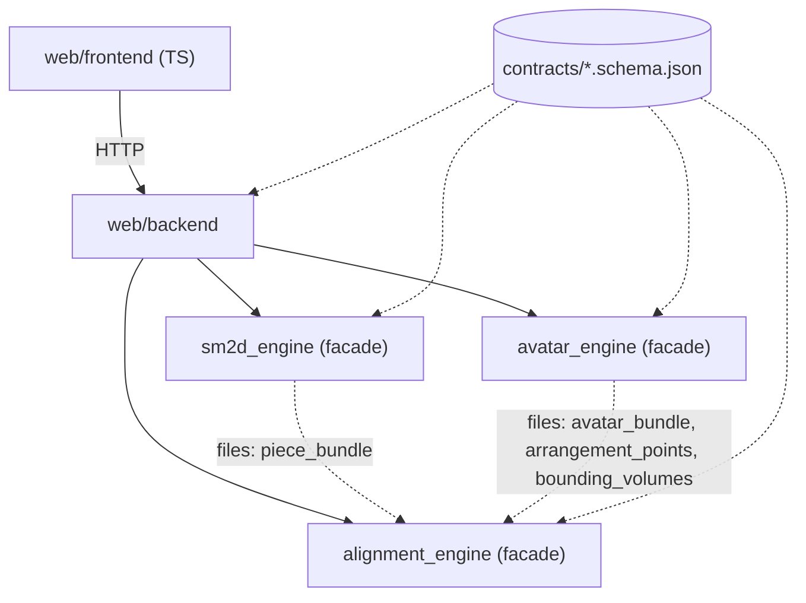
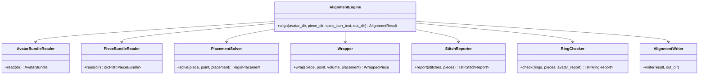
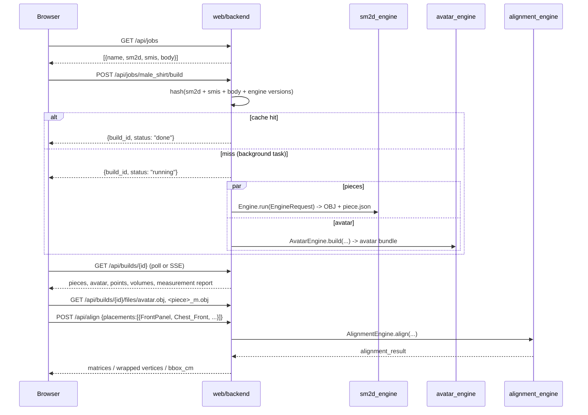

# LLD: avatar_engine, alignment_engine, web

Three new components on top of `sm2d_engine`. All geometry is in **metres**, y up, feet on y = 0. Nothing is ever scaled to fit.

## 0. Phase 0 findings

### 0.1 Model files (searched: `models/smplx/` and its subfolders, e.g. `smpl/`)

| File | Size | Use |
|---|---|---|
| `SMPLX_NEUTRAL.npz`, `SMPLX_MALE.npz`, `SMPLX_FEMALE.npz` | 108 MB each | **Used.** Keys: `v_template (10475,3)`, `shapedirs (10475,3,400)` (first 300 = shape, last 100 = expression), `J_regressor (55,10475)`, `weights (10475,55)`, `f (20908,3)`, `kintree_table (2,55)`. |
| `SMPLX_NEUTRAL.pkl`, `SMPLX_MALE.pkl`, `SMPLX_FEMALE.pkl` | 544 MB each | Not used (the `.npz` files hold the same arrays). |
| `smplx_npz.zip` | 91 MB | Compressed copies of the three `.npz` files. Not used. |
| `version.txt` | | "Version 1.0 of SMPL-X" |

- **No SMPL (6890-vertex) files are present.** SMPL support is written and unit-tested against a synthetic small model. It cannot be verified on real SMPL data on this machine.
- Both genders and neutral exist, so `gender` maps to a file without any fallback being needed.
- The `.npz` files contain pickled object arrays (`part2num`, `joint2num`). The loader reads only the six keys above, so nothing is unpickled.

### 0.2 Packages (checked with `importlib.metadata`)

| Package | State |
|---|---|
| numpy 2.4.4, scipy 1.17.1, trimesh 4.12.0, jsonschema 4.26.0, pyyaml 6.0.3, pydantic 2.13.4 | installed |
| fastapi 0.136.1, uvicorn 0.46.0, httpx 0.28.1 | installed |
| torch 2.13.0 | installed, **not needed** |
| playwright 1.63.0 (Python) | installed; `pytest-playwright` is not, and the Chromium download is unchecked |
| smplx | not installed |
| chumpy | not installed |
| import-linter | not installed |
| Node 24.12, npm 11.7 | installed (for Vite, three.js, vitest, eslint) |

### 0.3 Recommendation: load the `.npz` directly with numpy, no `smplx`, no `torch`, no `chumpy`

At zero pose, linear blend skinning is the identity and the pose blend shapes are zero. So the whole model reduces to:

```
v = v_template + shapedirs[:, :, :num_betas] @ betas          # (N,3), model units are metres
J = J_regressor @ v                                            # (K,3)
```

That is a few lines of numpy, runs in milliseconds, is CPU only, and is trivially differentiable for the fit (it is linear in betas). The `weights` matrix is only needed for bounding-volume assignment. Using `smplx` or `torch` would add about 2 GB of dependencies for the same result.

- **SMPL `.pkl`:** if a user supplies one, it is converted once into `<cache>/<name>.npz` with a restricted unpickler that stubs the `chumpy` classes. `chumpy` is never a dependency. This code path is tested on a synthetic pickle only.
- **Model selection:** `model_type` option (`smpl | smplx | auto`). `auto` prefers SMPL-X if present. A missing model raises `ModelFilesNotFoundError` listing every path searched.

### 0.4 Decisions I made that you may want to change

1. **Handedness.** The spec says "x right, y up, z forward (front = +z)" and "90° = left". With y up and z forward, +x is the *wearer's left* (it is "right" only from the viewer's side). I use **+x = body left**: `_L` points have x > 0, 90° means +x, and 270° means −x. The web view looks at the avatar from +z, so the wearer's left appears on the viewer's right. Tell me if you want x flipped instead.
2. **Rest pose is a T-pose** (zero pose, as specified). For arm bounding volumes, the arm axis is along ±x, so "Outer" means the surface facing +y and "Inner" means −y. This is the direction they would face if the arm hung down. Legs are vertical, so Outer means away from the midline in x. An A-pose option (shoulders rotated only) can be added later.
3. **Contracts are loaded per engine.** The engines may not import each other, so each carries its own ~15-line schema loader. The `contracts/` folder is found by walking up from the package file, or via `SM2D_CONTRACTS_DIR`.
4. **Import-rule test:** an AST-parsing pytest, with no `import-linter` dependency.
5. **Playwright:** needs `playwright install chromium` (about 150 MB download). I will run it in the web phase unless you object.
6. **Height definition:** top-of-head vertex minus the lowest foot vertex, after feet are placed on y = 0. The height target is weighted so heavily in the fit that it is met to < 1 mm. If 10 betas cannot do it inside ±3, the build raises `FitDidNotConvergeError` instead of scaling.

## 1. Dependency rules



- Solid arrows are imports. Dotted arrows are files only.
- `avatar_engine`, `alignment_engine` and `sm2d_engine` import nothing from each other or from `web`. The backend imports only `from <engine> import <Facade>`.
- `tests/test_architecture.py` parses every `.py` under `src/` with `ast` and fails on any forbidden edge.

## 2. Contracts (`contracts/`, JSON Schema draft 2020-12, `"schema_version": 1`)

Every file is validated on write and on read by the module that handles it. Units: metres unless a field name says otherwise.

| Schema | Written by | Key fields |
|---|---|---|
| `body_measurements` | user (`assert/body/*.json`) | `name`, `gender (male/female/neutral)`, `units (cm/mm/m)`, `measurements{name: number}` (any subset of the 12 known names), `options{num_betas, exact_circumferences}` |
| `avatar_bundle` | avatar engine | `units:"m"`, `model_type`, `model_file`, `gender`, `betas[]`, `target_cm{}`, `achieved_cm{}`, `mesh:"avatar.obj"`, `bbox_m{min,max}`, file names of the other outputs, `engine_version` |
| `bounding_volumes` | avatar engine | `volumes[]{name, kind:"capsule", axis_start, axis_end, radius_m, length_m, joint, child_joint}` |
| `arrangement_points` | avatar engine | `points[]{name, bv, angle_deg, t, offset_m, wrap_direction (around/flat), position_m, normal, up, tangent}` |
| `piece_bundle` (`<piece>.piece.json`) | sm2d engine | `name`, `units:"m"`, `obj`, `bbox_m`, `outline_m[[x,y]]`, `named_points[{name,label,xy_m,on_outline}]`, `edges[{from,to,length_m,outline_index_range}]`, `fold_edge\|null`, `grainline\|null`, `default_reference{type:"bbox_centre", xy_m}` |
| `placement_spec` | frontend / user | `placements[{piece, point, offset_m\|null, rotation_deg, mirror, wrap (flat/around), flip_facing, reference (string: "bbox_centre" or a named point)}]`, optional `stitches[{a:{piece,from_point,to_point}, b:{...}}]`, optional `rings[{name: chest/waist/hip, pieces[], avatar_measurement}]` |
| `alignment_result` | alignment engine | `units:"m"`, `placements[{piece, matrix[16] row-major, wrapped_vertices\|null, bbox_cm, reference_position_m, warnings[], fit{}}]`, `stitch_reports[]`, `ring_reports[]`, `warnings[]` |

## 3. sm2d_engine extension (Part B)

Class additions only: `pieces/bundle.py` (`PieceBundleBuilder`) and a call from `Engine.run` after each piece mesh is written. Existing outputs and tests are unchanged.

- **named_points:** Seamly points whose evaluated position lies on or inside the outline (tolerance 0.01 cm), converted to the piece frame. These are all placed points from `<calculation>`, not just the piece's path nodes. Points that were not evaluated for this piece are evaluated lazily by the scope.
- **edges:** boundary segments between consecutive named points that lie *on the outline*, arc length summed over the flattened outline.
- **fold_edge:** non-null only when `onFold="true"` and `foldPosition` is a defined value. In all three sample patterns this gives `null`. I do not guess.
- **grainline:** read from the piece's `<grainline>` element, which in this format stores only a rotation, length and centre anchor. Emitted only if the centre-anchor point is resolvable, else `null`.
- **default_reference:** bbox centre.

## 4. avatar_engine

```mermaid
classDiagram
    class AvatarEngine {
      +build(body_json_text, model_dir, out_dir, model_type=None) AvatarResult
    }
    class BodyModel { <<protocol>> +vertices(betas) ndarray; +joints(betas) ndarray; +faces; +skinning_weights; +num_betas; +joint_names }
    class SmplLikeModel { -v_template; -shapedirs; -J_regressor; -weights }
    class SmplBodyModel
    class SmplxBodyModel
    class ModelLocator { +locate(model_dir, gender, model_type) ModelFiles }
    class MeasurementDefinitions { +build(model) list~MeasurementDef~ }
    class MeasurementDef { <<abstract>> +name; +evaluate(vertices, joints) float }
    class RingDef { ring_vertex_ids; axis_joints; height_fraction }
    class LengthDef { landmarks or vertex_path }
    class ShapeFitter { +fit(model, defs, targets, num_betas) FitResult }
    class RingCorrector { +correct(vertices, rings, targets, joints) CorrectedMesh }
    class VolumeBuilder { +build(vertices, joints, weights) list~BoundingVolume~ }
    class PointBuilder { +build(volumes, vertices, faces, config) list~ArrangementPoint~ }
    class AvatarWriter { +write(result, out_dir) }
    AvatarEngine --> ModelLocator
    AvatarEngine --> BodyModel
    AvatarEngine --> MeasurementDefinitions
    AvatarEngine --> ShapeFitter
    AvatarEngine --> RingCorrector
    AvatarEngine --> VolumeBuilder
    AvatarEngine --> PointBuilder
    AvatarEngine --> AvatarWriter
    SmplLikeModel ..|> BodyModel
    SmplBodyModel --|> SmplLikeModel
    SmplxBodyModel --|> SmplLikeModel
    MeasurementDef <|-- RingDef
    MeasurementDef <|-- LengthDef
```



**Pipeline details**

- `BodyModel.vertices(betas)`: model units are metres. SMPL and SMPL-X are both y up, front +z, body left +x. The feet are translated so the lowest vertex has y = 0, and x is unchanged. Zero pose only.
- **Measurement definitions** are derived from the template with no vertex indices in code:
  - Joint indices 0 to 21 are shared by SMPL and SMPL-X (pelvis … wrists), so landmarks are expressed as "fraction between joint A and joint B".
  - **Circumference ring:** slice the template with a plane at the landmark height, perpendicular to the segment axis (horizontal for the torso and neck, perpendicular to the limb axis for limbs). Take the loop that encloses the segment axis, so the arms in T-pose are not included in the chest slice. Snap each crossing edge to its nearer endpoint, remove duplicates, order by angle about the axis. The ring's length is the sum of straight edge lengths between consecutive ring vertices (a polygon through vertices; this can differ from a tape measure by a millimetre or so, and is documented).
  - **Lengths:** straight lines between named landmarks, or a vertex path fixed once on the template (`arm_length`, `neck_back_to_waist`).
- `ShapeFitter`: `scipy.optimize.least_squares` (trf) with bounds ±3, start at 0, residual = (achieved − target) / tolerance (1 mm for height, 5 mm for the rest) plus `λ·betas`. Fully deterministic.
- `RingCorrector`: per ring, a radial scale about the local axis computed to hit the target length, with a smooth (cosine) falloff of the displacement along the axis. Reports pre- and post-correction error and warns if |scale − 1| > 10 %.
- `VolumeBuilder`: vertices are assigned to the joint with the highest skinning weight (if that weight > 0.5); capsule axis from joint to child joint; radius = 90th-percentile distance to the axis; length = projected extent.
- `PointBuilder`: for each config entry `(bv, angle_deg, t, offset_m, wrap_direction)`, cast a ray from the BV axis at the angle to the nearest mesh triangle (a numpy ray/triangle test restricted to the BV's vertices); position = hit + `offset_m` · normal. `normal` is the area-weighted surface normal at the hit, `up` the BV axis projected perpendicular to the normal, `tangent = up × normal`. `_L`/`_R` pairs are generated from one definition.

**Default point set** (`avatar_engine/default_points.yaml`, by BV, angle and `t` only):

| BV | Points |
|---|---|
| head, neck, chest, waist, hip | `<BV>_Front` (0°), `_Back` (180°), `_Left` (90°), `_Right` (270°) |
| upper arm, forearm, hand, thigh, shin, foot (each, `_L` and `_R`) | `<BV>_Front_<side>`, `_Back_<side>`, `_Outer_<side>`, `_Inner_<side>` |

That is 20 torso-column points and 48 limb points, 68 in total. Names are like `Chest_Front`, `UpperArm_Outer_L`. Default offset is 0.03 m, and 0.02 m for limbs. All defaults are editable.

**Outputs** (all floats written with fixed formatting, so two builds are byte-identical): `avatar.obj`, `bounding_volumes.json`, `arrangement_points.json`, `avatar_bundle.json`, `measurements_report.json` (target, pre-correction, achieved, error per measurement). Definitions of each measurement are documented in `docs/measurements.md`.

**CLI:** `avatar-engine build <body.json> --model-dir models/smplx --out outputs/x`.

## 5. alignment_engine



Pure functions in `placement.py` (all metres):

1. `frame_from_point(P, flip) -> (n, u, t)`: `n = ±P.normal`, `u = P.up − (P.up·n)n` normalised, `t = u × n`.
2. `rigid(piece_vertices, ref, frame, rotation_deg, offset_m, mirror) -> 4x4 + vertices`. Mirror reflects across `x = ref.x` first and flips the triangle winding. Then piece z → n, piece y → u, rotation about n, translate `ref → P.position + offset·n`.
3. `wrap(vertices, ref, volume, point, offset_m) -> vertices`. For each vertex, `s = x − ref.x`, `φ = s / R`, `R = point radius + offset`, and `y − ref.y` is the distance along the BV axis. The mapping preserves arc length along x and distance along y. If the piece's width > 2πR it warns (`WrapWidthExceededWarning`) and clamps.

The stitch report (milestone 2) uses the piece bundle's `outline_m` between named points, the cm and % differences, and arc-length resampled segments. The ring check sums piece widths against the avatar's matching circumference.

**CLI:** `alignment-engine run --avatar DIR --pieces DIR --spec spec.json --out DIR`.

## 6. web backend (FastAPI, `python -m web.backend`)

### Sequence: select job, build, align



### API

| Method and path | Purpose |
|---|---|
| `GET /api/jobs` | Jobs from `assert/jobs/*.json` |
| `POST /api/jobs/{name}/build` | Start (or reuse a cached) build, returns `build_id` |
| `GET /api/builds/{id}` | Status, progress and result (pieces with w×h cm, area and named points; avatar bundle; points; volumes; measurement report) |
| `GET /api/builds/{id}/files/{path}` | Avatar and piece OBJ, JSON files |
| `POST /api/align` | Placement spec in, alignment result out. The frontend never computes placement |
| `GET /api/jobs/{name}/placements`, `PUT …` | Load or save `outputs/<job>/placements.json` |
| `GET /api/export/{id}?format=obj\|glb` | Avatar plus placed pieces |

Errors come back as `{"error": {"code", "message", "piece"?, "tool"?}}`. A failed piece does not fail the build: it appears in the piece list with `status: "failed"` and a reason. Jobs: `male_shirt`, `aldrich_skirt` (two skirt pieces), `trousers`, each pointing at a body in `assert/body/`.

## 7. web frontend (Vite, TypeScript strict, three.js)

Modules: `api.ts`, `scene.ts`, `avatarView.ts`, `pointsView.ts`, `piecesView.ts`, `state.ts`, `ui/{topbar,pieceList,controls,measurements}.ts`. Only display transforms live here. The scene is in metres and y up. The camera looks from +z at start. The floor grid has 1 cm minor and 10 cm major lines, and a vertical ruler stands beside the avatar.

Interaction: select piece (highlight) then point, or point then piece, then `POST /api/align`, then tween to the returned transform. The sidebar's offset, rotation, mirror, flip, wrap and reference controls each call `/api/align`. A "scale check" readout shows the selected piece's bbox in cm from the response, so it can be compared before and after placement.

## 8. Test plan (each test written before its module)

| Area | Tests |
|---|---|
| contracts | Every sample file validates; invalid ones are rejected on write and on read |
| sm2d | `.piece.json` named points inside the bbox; edge lengths sum to the perimeter; existing 48 tests green |
| avatar 1 to 7 | As specified. The SMPL path is tested with a synthetic small model; a missing model gives `ModelFilesNotFoundError` |
| alignment 8 to 12 | As specified |
| architecture | AST import-rule test |
| web | pytest API tests (httpx `TestClient`) plus a Playwright e2e for `male_shirt`, `FrontPanel`, `Chest_Front` |

## 9. Implementation order

contracts, sm2d extension, avatar (model, measurements, fit, ring correction, volumes, points), alignment, backend, frontend.

## 10. As built: differences from the design above

* **Fit.** Circumferences are fitted loosely (5 cm per residual unit) and made exact by the ring correction; L2 weight 0.3, bounds +-5, 30 betas by default. Reason: with a tight circumference fit the shape components put extra girth mostly front to back (+10 cm chest moved `Chest_Front` by 2.5 cm instead of about 1.6 cm).
* **Rings** are loops of mesh-edge points (interpolated between vertices) rather than snapped vertices.
* **Symmetrisation.** The model is made left/right symmetric at load (the template vertices already are; the shape components and joint regressors are not).
* **Contracts.** `alignment_result` placements also carry `mirrored` and `wrapped_faces`; `body_measurements.num_betas` allows up to 1000; `piece_bundle.outline_m` allows 2 points (degenerate test pieces). `measurements_report.json` is not part of `contracts/`.
* **Placement defaults.** An absent `wrap` is `flat`. The offset always pushes the piece away from the body, also when `flip_facing` is set.
* **Wrapped pieces** are returned as a refined mesh (edges <= 1 cm), not the original triangles.
* **Backend.** Builds are polled (`GET /api/builds/{id}`), there is no SSE. `POST /api/align` takes `{build, placements, stitches?, rings?}`. Export uses the job's saved placements.
* **Import rule test** is an AST test (no import-linter). Each engine carries an identical `contracts.py` (a test fails if they drift).
* **Frontend** has a read-only `window.__fit` helper used by the browser test to find a point's screen position.

## 11. Half pieces: clone & mirror, pairs, side checks, body-slice wrap

### 11.1 Model (follows CLO3D: two pieces, never merged)

A half piece stays one piece. A **derived piece** is a linked mirrored copy made by the pure function
`mirror_clone(piece_bundle, mesh, axis, new_id)` in `alignment_engine/mirror.py`. The placement spec lists
`derived_pieces: [{id, source, op: "mirror", axis}]`; the engine builds them first (derived-of-derived is an error) and
then places base and derived pieces alike. Derived meshes are cached as `<id>_m.obj` + `<id>.piece.json` (schema
`piece_bundle` v2: `mirror_of`, `axis`, `origin_shift_m`).

* **Axis** is a 2D line: `bbox_center` (vertical through the bbox centre), `edge` (through two named points; general 2D
  reflection, so non-vertical edges work) or `x` (vertical at a piece x). Reflection `p' = p - 2((p - p0) . n) n`.
* **Winding and order.** A reflection reverses orientation, so the outline order becomes `[0, n-1, ..., 1]` (vertex 0
  stays first; arc positions become `perimeter - s`) and the mesh vertices are permuted the same way, so the outline is
  still exactly the mesh boundary; triangles get `[a, c, b]`, so normals stay +z.
* **Origin.** After reflecting, the geometry is translated so min x = min y = 0; the translation is `origin_shift_m`.
  The clone stores its own axis (an `edge` axis keeps its two names, which exist in the clone; `bbox_center` becomes
  `x`), so mirroring a clone with its own axis restores the source exactly (tested to 1e-12 m).
* Named point names stay identical in the clone; pieces are the namespace.

### 11.2 Pair placement (`place_pair`)

* `same_anchor` (centre-line pair): both copies get the same point, reference, offset, wrap and rotation. The reference
  must lie on the mirror axis (1 mm), else `ReferenceNotOnAxisError`. Because the reference is its own mirror image and
  the clone extends to the other side, both CF edges land on the same line on the body.
* `mirror_anchor` (side pair): the clone goes on the counterpart point (`_L` / `_R`, or `Left` / `Right`; a centre point
  maps to itself, else `NoMirroredPointError`), same offset / wrap / reference name, **rotation negated**. Algebra: the
  frame at the `_L` point is the x-mirror of the frame at `_R`, a mirrored piece placed with the negated angle is the exact
  mirror image of the original placement.

### 11.3 Side awareness

`extends` = `left` | `right` | `centre`: the area-weighted centroid of the placed piece relative to its reference, projected
on world +x (the wearer's left), centre if under 1 cm or 5 % of the piece width. Warnings are `CODE: text` strings:
`SIDE_UNLIKELY` (a `front` piece on a `Back` point or the reverse, using the source name for clones), `SIDE_MISMATCH`
(`_R` point and extends left, `_L` and right), `WRAP_OVERRUN`, `WRAP_FALLBACK`, `REFERENCE_NOT_ON_AXIS`.

### 11.4 Body-slice wrap (algorithm choice)

The engine only sees contract files (no skinning weights), so the torso is found geometrically: the torso axis is the
polyline through the Hip, Waist, Chest and Neck volume axes, and triangles within an arm volume (radius x 1.05) are
excluded, so T-pose arms never enter a section. For heights from the crotch to mid neck (every 1 cm) the filtered mesh is
sliced horizontally and a radial profile `r(theta)` (1 degree steps, `theta` 0 = front, 90 = +x) is read off the segments
(farthest hit; gaps where the arm was cut out are filled by interpolation in angle). A piece vertex at row `h` goes to world
height `y_anchor + h`, and to the point of that height's loop whose arc length from the anchor equals its horizontal offset
`s` (direction of increasing `theta` = the point's tangent), pushed out by the offset along the horizontal loop normal.
Why not the cylinder: a cylinder has one radius, a torso is a changing ellipse; the loop keeps arc length along each row
exact. Why not a surface geodesic mesh unfold: far more machinery and slow, and the garment is not simulated anyway.
Limits: vertical distance is preserved in world height, not along the surface (shoulder slope, bust); the offset is along
the horizontal normal, so on sloped surfaces the true perpendicular distance is a little smaller; the arm holes are closed
by interpolation.

### 11.6 As built (differences from 11.1 to 11.5)

* **Order.** All engine work (A, B, C, A5) was done before the web work, so the web defaults (`body_slice` on torso points) shipped together with the UI.
* **Torso sections** use the first skin hit from the axis (the farthest hit picked up the arm in the armpit), keep the shoulder cap (first 12 % of the upper arm), are smoothed (3 degrees, 1 cm), and the arc of a row is measured on the skin loop pushed out by the offset (an offset curve is longer than the skin loop, so measuring on the skin gave 21 % too much).
* **Contracts.** `schema_version` 1 and 2 are accepted by `placement_spec`, `piece_bundle` and `alignment_result`; the engines write 2. `body_measurements`, `avatar_bundle` and the other schemas are unchanged. Engine versions are 0.2.0, which also invalidates old build caches.
* **Occlusion** is computed on the GPU: the avatar is rendered into a packed-depth target (half resolution) and read back once per camera change.
* The suggested CF seam is sent as a stitch by the frontend, so the API answer proves that the CF edges coincide (segment gaps < 1e-6 m).

### 11.5 Ring multiplicity

A ring check expands each listed piece with its derived clones (`include_clones`, default true) so a shirt chest is
`2 x front + 2 x back`; `level_point` measures the width at the height of a named point (else the bbox width).
For an `edge` pair the engine suggests a stitch between the same edge on both copies.


## 12. Auto-arrange (exploded arrangement)

### 12.1 Problem (measured before any code)

With `body_slice` or `around`, a flat piece is wrapped onto the skin at the offset of its arrangement point. Measured on
`male_shirt` / `male_173` (front pair, back pair, sleeves): the pieces of one ring are 144 cm wide in total on a 100 cm loop,
so they interpenetrate; the largest triangles of the source meshes (outline-only triangulation) are flat chords through the
body (min distance to the avatar well below zero in the interior); and nothing is a gap wide enough to draw a seam.
`refine_piece` (Part A) fixes the chords, the shells (Part B) and the solver (Part C) create the space.

### 12.2 Parts

* `refine.py` - conforming Delaunay triangulation of the outline (scipy + shapely), outline vertices unchanged, edges <= 1 cm,
  normals +z, cached by outline hash. A self-touching outline (placket slit of `FullSleeve`) falls back to midpoint subdivision.
* `shells.py` - regions torso/neck/arm_L/arm_R/leg_L/leg_R from the bounding volumes. The cross-section at axial position `p` is a
  convex polygon: the support function of the region vertices within a window (`clearance + 1 cm`) along the axis,
  enveloped and Gaussian-smoothed over the rows (so the perimeter does not jump from row to row), torso and neck also
  symmetrised about the sagittal plane. Offset by `h` the polygon has length `perimeter + 2 pi h` (Steiner), exactly; arc
  coordinate <-> position is closed form (`stack.py`, vectorised over all 1 mm rows).
* `arrange.py` - the solver. A piece vertex at flat offset `(x, y)` from the reference goes to the row `p0 + shift + L(y)`
  and to arc distance `x` from the anchor ray of that row; `L` is the surface length along the axis so vertical edges keep their length on
  tilted shells. Arc length along a row and distance along the axis are therefore exact.

### 12.3 Algorithm

1. Refine every free piece (cached), unroll it, assign layers (a piece covering >= 40 % of a larger piece of its ring gets
   that piece's layer + 1; `layer` in the spec overrides).
2. Per ring (uniform standoff `h`, display space): `h` is the larger of (a) the row-sum bound
   `max_rows (sum of piece widths + n * gap_piece - perimeter) / 2 pi`, and (b) the standoff at which every sampled vertex
   (outline and interior) is `clearance_body` from the *whole avatar*, found by a secant iteration on the signed distance
   (this is what lifts the torso shell off the T-pose arms at the armpits). `standoff_mode = per_row` smooths a per-row need
   (max filter 3 cm then blur 1.5 cm) instead of a constant.
3. Relaxation (<= 30 iterations): pieces of the same layer closer than `gap_piece` are pushed apart along their own surface
   (arc/axis components of the separating direction), damped, each clamped to `max_shift` from its initial shift. Locked pieces
   never move and are obstacles. A sleeve alone on its ring slides along the axis only; across rings the arm yields to the torso.
4. The standoff depends on positions and positions on the standoff: rounds alternate until both are stable; gap shortfalls the
   row sums cannot see (slanted edges) are added to the ring standoff by a secant iteration; a final "settle" restarts from the
   found shifts, so the result is a fixed point and a rerun with `shift_m` = the reported shifts changes nothing (< 0.1 mm).
5. Layers sit at `h + k * gap_layer` (measured along the 3D normal: the offset is scaled by the local tilt secant, then corrected in
   a closed loop against the layer below).
6. If a ring needs more than `max_standoff` the shell is shown at `max_standoff`, `STANDOFF_EXCEEDED` is reported with the needed
   value and the rows, nothing is clamped silently.

### 12.4 Standoff is display space, never ease

`arrangement.rings[].true_ease_m = garment loop - skin loop` at the binding row (widest garment against the convex section),
where the garment loop is the sum of the flat widths of the ring's pieces and the skin loop is a radial first-hit loop of
the actual mesh. Neither depends on the standoff, the gap or the clearance (test 5 reruns with other options and compares).

### 12.5 Verification and report (`arrange_report.py`)

Measured on the placed meshes, independent of the solver: signed distance to the avatar (vertices, outline, interior), pairwise
minimum distances (`CLEARANCE_BODY`, `GAP_PIECES` flags and warnings), self-overlap count, 3D area / flat area, edge-length
change (median, p90, max; shoulder/underarm rows with a steep perimeter slope reported separately), world outline, named points
and edges (`world_edges`, clickable in the UI), `seam_candidates` (edge pairs of the same layer closer than 3 gap_piece and
running side by side for >= 2 of 21 samples) and the per-ring table. Schema `schema_version` 3 (v1/v2 documents still validate).

### 12.6 Limits (measured, not hidden)

* A flat piece cannot be wrapped onto a double-curved body without stretch (Gauss). Row arcs and axial lengths are exact; diagonal
  edges are not: median edge change about 0.9 %, p90 about 3 - 10 % (panels), worst edges 20 - 45 % in the shoulder/underarm
  bands (reported separately as `max_edge_change_shoulder_pct`). A strain-minimising warp of the flat coordinates was tried:
  it brought p90 to 2 - 3 % but broke the exact row arc length (BackPanel rows 0.93 - 1.01) and was removed.
* Regions follow the T-pose: an arm region starts after the shoulder cap, a sleeve longer than the arm or placed over the shoulder
  leaves the shell (`SHELL_RANGE`; `FullSleeve` is 62 cm on a 44 cm arm and shows `CLEARANCE_BODY`).
* `refine_piece` has a fallback only for self-touching outlines; its triangles are slivers (midpoint subdivision).
* Pieces on different layers are only kept `gap_layer` apart (measured on 3D samples), not `gap_piece`.
* Time: 6 pieces 2.6 s warm / 9 s cold (refinement cache), 17 pieces 7 s warm on this CPU. Over HTTP while a browser renders
  with software GL (SwiftShader) it was 100 s: the CPU is shared.
