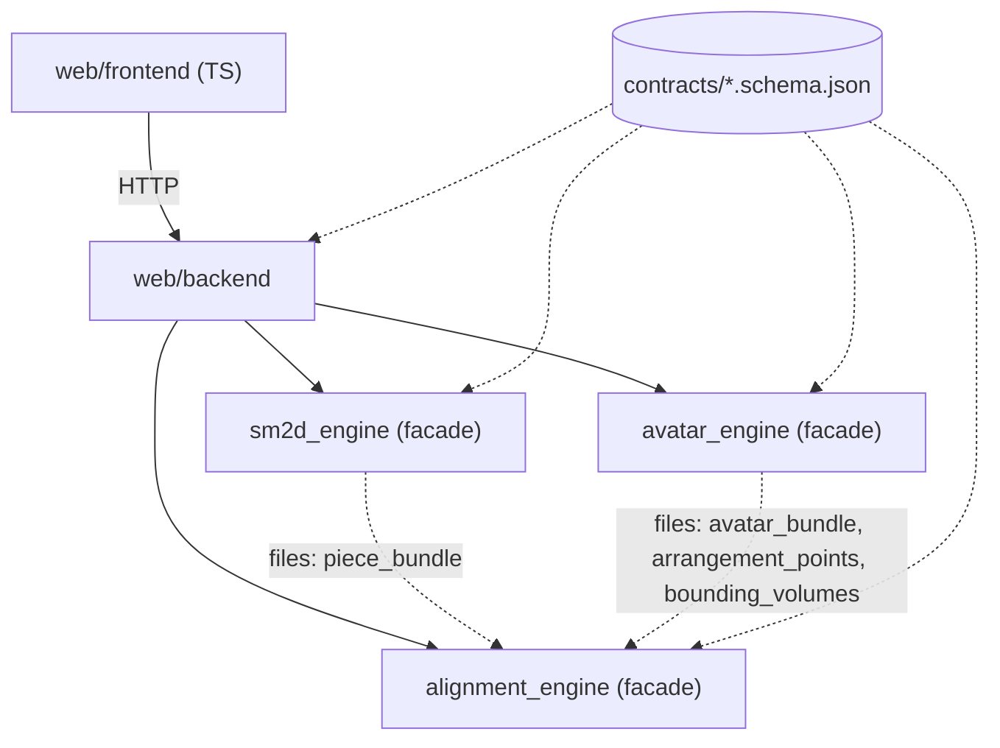
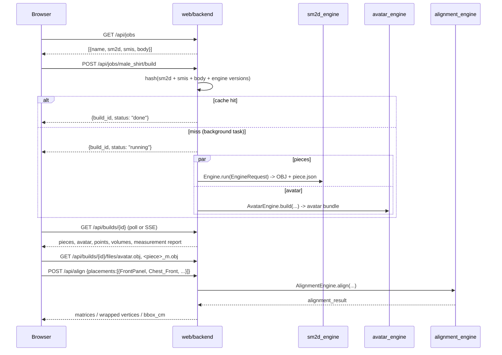

# LLD: avatar_engine, alignment_engine, web

Three new components on top of `sm2d_engine`. All geometry is in **metres**, y up, feet on y = 0. Nothing is ever scaled to fit.

## 0. Phase 0 findings

### 0.1 Model files (searched: `models/smplx/` and its subfolders, e.g. `smpl/`)

| File | Size | Use |
|---|---|---|
| `SMPLX_NEUTRAL.npz`, `SMPLX_MALE.npz`, `SMPLX_FEMALE.npz` | 108 MB each | **Used.** Keys: `v_template (10475,3)`, `shapedirs (10475,3,400)` (first 300 = shape, last 100 = expression), `J_regressor (55,10475)`, `weights (10475,55)`, `f (20908,3)`, `kintree_table (2,55)`. |
| `SMPLX_NEUTRAL.pkl`, `SMPLX_MALE.pkl`, `SMPLX_FEMALE.pkl` | 544 MB each | Not used (the `.npz` files hold the same arrays). |
| `smplx_npz.zip` | 91 MB | Compressed copies of the three `.npz` files. Not used. |
| `version.txt` | | "Version 1.0 of SMPL-X" |

- **No SMPL (6890-vertex) files are present.** SMPL support is written and unit-tested against a synthetic small model. It cannot be verified on real SMPL data on this machine.
- Both genders and neutral exist, so `gender` maps to a file without any fallback being needed.
- The `.npz` files contain pickled object arrays (`part2num`, `joint2num`). The loader reads only the six keys above, so nothing is unpickled.

### 0.2 Packages (checked with `importlib.metadata`)

| Package | State |
|---|---|
| numpy 2.4.4, scipy 1.17.1, trimesh 4.12.0, jsonschema 4.26.0, pyyaml 6.0.3, pydantic 2.13.4 | installed |
| fastapi 0.136.1, uvicorn 0.46.0, httpx 0.28.1 | installed |
| torch 2.13.0 | installed, **not needed** |
| playwright 1.63.0 (Python) | installed; `pytest-playwright` is not, and the Chromium download is unchecked |
| smplx | not installed |
| chumpy | not installed |
| import-linter | not installed |
| Node 24.12, npm 11.7 | installed (for Vite, three.js, vitest, eslint) |

### 0.3 Recommendation: load the `.npz` directly with numpy, no `smplx`, no `torch`, no `chumpy`

At zero pose, linear blend skinning is the identity and the pose blend shapes are zero. So the whole model reduces to:

```
v = v_template + shapedirs[:, :, :num_betas] @ betas          # (N,3), model units are metres
J = J_regressor @ v                                            # (K,3)
```

That is a few lines of numpy, runs in milliseconds, is CPU only, and is trivially differentiable for the fit (it is linear in betas). The `weights` matrix is only needed for bounding-volume assignment. Using `smplx` or `torch` would add about 2 GB of dependencies for the same result.

- **SMPL `.pkl`:** if a user supplies one, it is converted once into `<cache>/<name>.npz` with a restricted unpickler that stubs the `chumpy` classes. `chumpy` is never a dependency. This code path is tested on a synthetic pickle only.
- **Model selection:** `model_type` option (`smpl | smplx | auto`). `auto` prefers SMPL-X if present. A missing model raises `ModelFilesNotFoundError` listing every path searched.

### 0.4 Decisions I made that you may want to change

1. **Handedness.** The spec says "x right, y up, z forward (front = +z)" and "90° = left". With y up and z forward, +x is the *wearer's left* (it is "right" only from the viewer's side). I use **+x = body left**: `_L` points have x > 0, 90° means +x, and 270° means −x. The web view looks at the avatar from +z, so the wearer's left appears on the viewer's right. Tell me if you want x flipped instead.
2. **Rest pose is a T-pose** (zero pose, as specified). For arm bounding volumes, the arm axis is along ±x, so "Outer" means the surface facing +y and "Inner" means −y. This is the direction they would face if the arm hung down. Legs are vertical, so Outer means away from the midline in x. An A-pose option (shoulders rotated only) can be added later.
3. **Contracts are loaded per engine.** The engines may not import each other, so each carries its own ~15-line schema loader. The `contracts/` folder is found by walking up from the package file, or via `SM2D_CONTRACTS_DIR`.
4. **Import-rule test:** an AST-parsing pytest, with no `import-linter` dependency.
5. **Playwright:** needs `playwright install chromium` (about 150 MB download). I will run it in the web phase unless you object.
6. **Height definition:** top-of-head vertex minus the lowest foot vertex, after feet are placed on y = 0. The height target is weighted so heavily in the fit that it is met to < 1 mm. If 10 betas cannot do it inside ±3, the build raises `FitDidNotConvergeError` instead of scaling.

## 1. Dependency rules



- Solid arrows are imports. Dotted arrows are files only.
- `avatar_engine`, `alignment_engine` and `sm2d_engine` import nothing from each other or from `web`. The backend imports only `from <engine> import <Facade>`.
- `tests/test_architecture.py` parses every `.py` under `src/` with `ast` and fails on any forbidden edge.

## 2. Contracts (`contracts/`, JSON Schema draft 2020-12, `"schema_version": 1`)

Every file is validated on write and on read by the module that handles it. Units: metres unless a field name says otherwise.

| Schema | Written by | Key fields |
|---|---|---|
| `body_measurements` | user (`assert/body/*.json`) | `name`, `gender (male/female/neutral)`, `units (cm/mm/m)`, `measurements{name: number}` (any subset of the 12 known names), `options{num_betas, exact_circumferences}` |
| `avatar_bundle` | avatar engine | `units:"m"`, `model_type`, `model_file`, `gender`, `betas[]`, `target_cm{}`, `achieved_cm{}`, `mesh:"avatar.obj"`, `bbox_m{min,max}`, file names of the other outputs, `engine_version` |
| `bounding_volumes` | avatar engine | `volumes[]{name, kind:"capsule", axis_start, axis_end, radius_m, length_m, joint, child_joint}` |
| `arrangement_points` | avatar engine | `points[]{name, bv, angle_deg, t, offset_m, wrap_direction (around/flat), position_m, normal, up, tangent}` |
| `piece_bundle` (`<piece>.piece.json`) | sm2d engine | `name`, `units:"m"`, `obj`, `bbox_m`, `outline_m[[x,y]]`, `named_points[{name,label,xy_m,on_outline}]`, `edges[{from,to,length_m,outline_index_range}]`, `fold_edge\|null`, `grainline\|null`, `default_reference{type:"bbox_centre", xy_m}` |
| `placement_spec` | frontend / user | `placements[{piece, point, offset_m\|null, rotation_deg, mirror, wrap (flat/around), flip_facing, reference (string: "bbox_centre" or a named point)}]`, optional `stitches[{a:{piece,from_point,to_point}, b:{...}}]`, optional `rings[{name: chest/waist/hip, pieces[], avatar_measurement}]` |
| `alignment_result` | alignment engine | `units:"m"`, `placements[{piece, matrix[16] row-major, wrapped_vertices\|null, bbox_cm, reference_position_m, warnings[], fit{}}]`, `stitch_reports[]`, `ring_reports[]`, `warnings[]` |

## 3. sm2d_engine extension (Part B)

Class additions only: `pieces/bundle.py` (`PieceBundleBuilder`) and a call from `Engine.run` after each piece mesh is written. Existing outputs and tests are unchanged.

- **named_points:** Seamly points whose evaluated position lies on or inside the outline (tolerance 0.01 cm), converted to the piece frame. These are all placed points from `<calculation>`, not just the piece's path nodes. Points that were not evaluated for this piece are evaluated lazily by the scope.
- **edges:** boundary segments between consecutive named points that lie *on the outline*, arc length summed over the flattened outline.
- **fold_edge:** non-null only when `onFold="true"` and `foldPosition` is a defined value. In all three sample patterns this gives `null`. I do not guess.
- **grainline:** read from the piece's `<grainline>` element, which in this format stores only a rotation, length and centre anchor. Emitted only if the centre-anchor point is resolvable, else `null`.
- **default_reference:** bbox centre.

## 4. avatar_engine


**Pipeline details**

- `BodyModel.vertices(betas)`: model units are metres. SMPL and SMPL-X are both y up, front +z, body left +x. The feet are translated so the lowest vertex has y = 0, and x is unchanged. Zero pose only.
- **Measurement definitions** are derived from the template with no vertex indices in code:
  - Joint indices 0 to 21 are shared by SMPL and SMPL-X (pelvis … wrists), so landmarks are expressed as "fraction between joint A and joint B".
  - **Circumference ring:** slice the template with a plane at the landmark height, perpendicular to the segment axis (horizontal for the torso and neck, perpendicular to the limb axis for limbs). Take the loop that encloses the segment axis, so the arms in T-pose are not included in the chest slice. Snap each crossing edge to its nearer endpoint, remove duplicates, order by angle about the axis. The ring's length is the sum of straight edge lengths between consecutive ring vertices (a polygon through vertices; this can differ from a tape measure by a millimetre or so, and is documented).
  - **Lengths:** straight lines between named landmarks, or a vertex path fixed once on the template (`arm_length`, `neck_back_to_waist`).
- `ShapeFitter`: `scipy.optimize.least_squares` (trf) with bounds ±3, start at 0, residual = (achieved − target) / tolerance (1 mm for height, 5 mm for the rest) plus `λ·betas`. Fully deterministic.
- `RingCorrector`: per ring, a radial scale about the local axis computed to hit the target length, with a smooth (cosine) falloff of the displacement along the axis. Reports pre- and post-correction error and warns if |scale − 1| > 10 %.
- `VolumeBuilder`: vertices are assigned to the joint with the highest skinning weight (if that weight > 0.5); capsule axis from joint to child joint; radius = 90th-percentile distance to the axis; length = projected extent.
- `PointBuilder`: for each config entry `(bv, angle_deg, t, offset_m, wrap_direction)`, cast a ray from the BV axis at the angle to the nearest mesh triangle (a numpy ray/triangle test restricted to the BV's vertices); position = hit + `offset_m` · normal. `normal` is the area-weighted surface normal at the hit, `up` the BV axis projected perpendicular to the normal, `tangent = up × normal`. `_L`/`_R` pairs are generated from one definition.

**Default point set** (`avatar_engine/default_points.yaml`, by BV, angle and `t` only):

| BV | Points |
|---|---|
| head, neck, chest, waist, hip | `<BV>_Front` (0°), `_Back` (180°), `_Left` (90°), `_Right` (270°) |
| upper arm, forearm, hand, thigh, shin, foot (each, `_L` and `_R`) | `<BV>_Front_<side>`, `_Back_<side>`, `_Outer_<side>`, `_Inner_<side>` |

That is 20 torso-column points and 48 limb points, 68 in total. Names are like `Chest_Front`, `UpperArm_Outer_L`. Default offset is 0.03 m, and 0.02 m for limbs. All defaults are editable.

**Outputs** (all floats written with fixed formatting, so two builds are byte-identical): `avatar.obj`, `bounding_volumes.json`, `arrangement_points.json`, `avatar_bundle.json`, `measurements_report.json` (target, pre-correction, achieved, error per measurement). Definitions of each measurement are documented in `docs/measurements.md`.

**CLI:** `avatar-engine build <body.json> --model-dir models/smplx --out outputs/x`.

## 5. alignment_engine


Pure functions in `placement.py` (all metres):

1. `frame_from_point(P, flip) -> (n, u, t)`: `n = ±P.normal`, `u = P.up − (P.up·n)n` normalised, `t = u × n`.
2. `rigid(piece_vertices, ref, frame, rotation_deg, offset_m, mirror) -> 4x4 + vertices`. Mirror reflects across `x = ref.x` first and flips the triangle winding. Then piece z → n, piece y → u, rotation about n, translate `ref → P.position + offset·n`.
3. `wrap(vertices, ref, volume, point, offset_m) -> vertices`. For each vertex, `s = x − ref.x`, `φ = s / R`, `R = point radius + offset`, and `y − ref.y` is the distance along the BV axis. The mapping preserves arc length along x and distance along y. If the piece's width > 2πR it warns (`WrapWidthExceededWarning`) and clamps.

The stitch report (milestone 2) uses the piece bundle's `outline_m` between named points, the cm and % differences, and arc-length resampled segments. The ring check sums piece widths against the avatar's matching circumference.

**CLI:** `alignment-engine run --avatar DIR --pieces DIR --spec spec.json --out DIR`.

## 6. web backend (FastAPI, `python -m web.backend`)

### Sequence: select job, build, align



### API

| Method and path | Purpose |
|---|---|
| `GET /api/jobs` | Jobs from `assert/jobs/*.json` |
| `POST /api/jobs/{name}/build` | Start (or reuse a cached) build, returns `build_id` |
| `GET /api/builds/{id}` | Status, progress and result (pieces with w×h cm, area and named points; avatar bundle; points; volumes; measurement report) |
| `GET /api/builds/{id}/files/{path}` | Avatar and piece OBJ, JSON files |
| `POST /api/align` | Placement spec in, alignment result out. The frontend never computes placement |
| `GET /api/jobs/{name}/placements`, `PUT …` | Load or save `outputs/<job>/placements.json` |
| `GET /api/export/{id}?format=obj\|glb` | Avatar plus placed pieces |

Errors come back as `{"error": {"code", "message", "piece"?, "tool"?}}`. A failed piece does not fail the build: it appears in the piece list with `status: "failed"` and a reason. Jobs: `male_shirt`, `aldrich_skirt` (two skirt pieces), `trousers`, each pointing at a body in `assert/body/`.

## 7. web frontend (Vite, TypeScript strict, three.js)

Modules: `api.ts`, `scene.ts`, `avatarView.ts`, `pointsView.ts`, `piecesView.ts`, `state.ts`, `ui/{topbar,pieceList,controls,measurements}.ts`. Only display transforms live here. The scene is in metres and y up. The camera looks from +z at start. The floor grid has 1 cm minor and 10 cm major lines, and a vertical ruler stands beside the avatar.

Interaction: select piece (highlight) then point, or point then piece, then `POST /api/align`, then tween to the returned transform. The sidebar's offset, rotation, mirror, flip, wrap and reference controls each call `/api/align`. A "scale check" readout shows the selected piece's bbox in cm from the response, so it can be compared before and after placement.

## 8. Test plan (each test written before its module)

| Area | Tests |
|---|---|
| contracts | Every sample file validates; invalid ones are rejected on write and on read |
| sm2d | `.piece.json` named points inside the bbox; edge lengths sum to the perimeter; existing 48 tests green |
| avatar 1 to 7 | As specified. The SMPL path is tested with a synthetic small model; a missing model gives `ModelFilesNotFoundError` |
| alignment 8 to 12 | As specified |
| architecture | AST import-rule test |
| web | pytest API tests (httpx `TestClient`) plus a Playwright e2e for `male_shirt`, `FrontPanel`, `Chest_Front` |

## 9. Implementation order

contracts, sm2d extension, avatar (model, measurements, fit, ring correction, volumes, points), alignment, backend, frontend.

## 10. As built: differences from the design above

* **Fit.** Circumferences are fitted loosely (5 cm per residual unit) and made exact by the ring correction; L2 weight 0.3, bounds +-5, 30 betas by default. Reason: with a tight circumference fit the shape components put extra girth mostly front to back (+10 cm chest moved `Chest_Front` by 2.5 cm instead of about 1.6 cm).
* **Rings** are loops of mesh-edge points (interpolated between vertices) rather than snapped vertices.
* **Symmetrisation.** The model is made left/right symmetric at load (the template vertices already are; the shape components and joint regressors are not).
* **Contracts.** `alignment_result` placements also carry `mirrored` and `wrapped_faces`; `body_measurements.num_betas` allows up to 1000; `piece_bundle.outline_m` allows 2 points (degenerate test pieces). `measurements_report.json` is not part of `contracts/`.
* **Placement defaults.** An absent `wrap` is `flat`. The offset always pushes the piece away from the body, also when `flip_facing` is set.
* **Wrapped pieces** are returned as a refined mesh (edges <= 1 cm), not the original triangles.
* **Backend.** Builds are polled (`GET /api/builds/{id}`), there is no SSE. `POST /api/align` takes `{build, placements, stitches?, rings?}`. Export uses the job's saved placements.
* **Import rule test** is an AST test (no import-linter). Each engine carries an identical `contracts.py` (a test fails if they drift).
* **Frontend** has a read-only `window.__fit` helper used by the browser test to find a point's screen position.

## 11. Half pieces: clone & mirror, pairs, side checks, body-slice wrap

### 11.1 Model (follows CLO3D: two pieces, never merged)

A half piece stays one piece. A **derived piece** is a linked mirrored copy made by the pure function
`mirror_clone(piece_bundle, mesh, axis, new_id)` in `alignment_engine/mirror.py`. The placement spec lists
`derived_pieces: [{id, source, op: "mirror", axis}]`; the engine builds them first (derived-of-derived is an error) and
then places base and derived pieces alike. Derived meshes are cached as `<id>_m.obj` + `<id>.piece.json` (schema
`piece_bundle` v2: `mirror_of`, `axis`, `origin_shift_m`).
A plain copy (`{id, source, op: "copy"}`, no `axis`; the UI's **Clone**) is made by `copy_clone` (same geometry and
orientation, `clone_of`); it is an ordinary piece and never half of a pair (see `src/alignment_engine/README.md`).

* **Axis** is a 2D line: `bbox_center` (vertical through the bbox centre), `edge` (through two named points; general 2D
  reflection, so non-vertical edges work) or `x` (vertical at a piece x). Reflection `p' = p - 2((p - p0) . n) n`.
* **Winding and order.** A reflection reverses orientation, so the outline order becomes `[0, n-1, ..., 1]` (vertex 0
  stays first; arc positions become `perimeter - s`) and the mesh vertices are permuted the same way, so the outline is
  still exactly the mesh boundary; triangles get `[a, c, b]`, so normals stay +z.
* **Origin.** After reflecting, the geometry is translated so min x = min y = 0; the translation is `origin_shift_m`.
  The clone stores its own axis (an `edge` axis keeps its two names, which exist in the clone; `bbox_center` becomes
  `x`), so mirroring a clone with its own axis restores the source exactly (tested to 1e-12 m).
* Named point names stay identical in the clone; pieces are the namespace.

### 11.2 Pair placement (`place_pair`)

* `same_anchor` (centre-line pair): both copies get the same point, reference, offset, wrap and rotation. The reference
  must lie on the mirror axis (1 mm), else `ReferenceNotOnAxisError`. Because the reference is its own mirror image and
  the clone extends to the other side, both CF edges land on the same line on the body.
* `mirror_anchor` (side pair): the clone goes on the counterpart point (`_L` / `_R`, or `Left` / `Right`; a centre point
  maps to itself, else `NoMirroredPointError`), same offset / wrap / reference name, **rotation negated**. Algebra: the
  frame at the `_L` point is the x-mirror of the frame at `_R`, a mirrored piece placed with the negated angle is the exact
  mirror image of the original placement.

### 11.3 Side awareness

`extends` = `left` | `right` | `centre`: the area-weighted centroid of the placed piece relative to its reference, projected
on world +x (the wearer's left), centre if under 1 cm or 5 % of the piece width. Warnings are `CODE: text` strings:
`SIDE_UNLIKELY` (a `front` piece on a `Back` point or the reverse, using the source name for clones), `SIDE_MISMATCH`
(`_R` point and extends left, `_L` and right), `WRAP_OVERRUN`, `WRAP_FALLBACK`, `REFERENCE_NOT_ON_AXIS`.

### 11.4 Body-slice wrap (algorithm choice)

The engine only sees contract files (no skinning weights), so the torso is found geometrically: the torso axis is the
polyline through the Hip, Waist, Chest and Neck volume axes, and triangles within an arm volume (radius x 1.05) are
excluded, so T-pose arms never enter a section. For heights from the crotch to mid neck (every 1 cm) the filtered mesh is
sliced horizontally and a radial profile `r(theta)` (1 degree steps, `theta` 0 = front, 90 = +x) is read off the segments
(farthest hit; gaps where the arm was cut out are filled by interpolation in angle). A piece vertex at row `h` goes to world
height `y_anchor + h`, and to the point of that height's loop whose arc length from the anchor equals its horizontal offset
`s` (direction of increasing `theta` = the point's tangent), pushed out by the offset along the horizontal loop normal.
Why not the cylinder: a cylinder has one radius, a torso is a changing ellipse; the loop keeps arc length along each row
exact. Why not a surface geodesic mesh unfold: far more machinery and slow, and the garment is not simulated anyway.
Limits: vertical distance is preserved in world height, not along the surface (shoulder slope, bust); the offset is along
the horizontal normal, so on sloped surfaces the true perpendicular distance is a little smaller; the arm holes are closed
by interpolation.

### 11.6 As built (differences from 11.1 to 11.5)

* **Order.** All engine work (A, B, C, A5) was done before the web work, so the web defaults (`body_slice` on torso points) shipped together with the UI.
* **Torso sections** use the first skin hit from the axis (the farthest hit picked up the arm in the armpit), keep the shoulder cap (first 12 % of the upper arm), are smoothed (3 degrees, 1 cm), and the arc of a row is measured on the skin loop pushed out by the offset (an offset curve is longer than the skin loop, so measuring on the skin gave 21 % too much).
* **Contracts.** `schema_version` 1 and 2 are accepted by `placement_spec`, `piece_bundle` and `alignment_result`; the engines write 2. `body_measurements`, `avatar_bundle` and the other schemas are unchanged. Engine versions are 0.2.0, which also invalidates old build caches.
* **Occlusion** is computed on the GPU: the avatar is rendered into a packed-depth target (half resolution) and read back once per camera change.
* The suggested CF seam is sent as a stitch by the frontend, so the API answer proves that the CF edges coincide (segment gaps < 1e-6 m).

### 11.5 Ring multiplicity

A ring check expands each listed piece with its derived clones (`include_clones`, default true) so a shirt chest is
`2 x front + 2 x back`; `level_point` measures the width at the height of a named point (else the bbox width).
For an `edge` pair the engine suggests a stitch between the same edge on both copies.


## 12. Size-exact, collision-free placement (align and auto-arrange)

This section replaces the earlier shell/hull arrangement. That design mapped every piece row by row onto the offset
convex hull of the body; a flat piece cannot follow a double-curved surface without stretch (Gauss), and the measured
result was a median edge change of about 0.9 %, p90 3 - 10 % and 20 - 45 % at the shoulders. A fit check cannot use
pieces whose measurements change, so that mapping is gone from the placement path.

### 12.1 Problem (measured before any code, `male_173`, the 17-piece shirt plus front pair, back pair, mirrored sleeves)

| | before |
|---|---|
| edge-length change, `body_slice` (UI default on the torso) | median 0.01 - 3.9 %, p90 up to 54 %, max up to 6000 % (FrontPanel) |
| edge-length change, `around` (UI default on limbs) | sleeves clamped: p90 54 %, max 100 - 1380 % |
| edge-length change, `/api/arrange` | FrontPanel/sleeves median 8 - 50 %, max 300 - 8400 % |
| pairs closer than 3 cm in the normal aligning flow | 49 (most at 0 mm: pieces on the same point lie on top of each other) |
| pieces closer than 3 cm to the avatar in the normal flow | 20 of 21 (8 inside the body, down to -5.4 cm) |
| pairs closer than 3 cm after `/api/arrange` | 23 (FrontPanel / FrontPanel_L and FrontPanel / CollarBase at 0 mm) |

Findings: (1) sizes changed by design; (2) only the separate Auto-arrange button avoided collisions, clicking a point did
not; (3) the gap was only enforced for pieces of the same layer, outline to outline, 30 iterations, 6 cm shift cap,
facing pairs skipped; (4) no test proved it on a realistic scene and all of them needed SMPL-X; (5) pieces on the same
point started stacked.

### 12.2 Size-exact surfaces (`roll.py`)

Only isometries of the flat piece are used. A local point `(x, y)` (piece coordinates relative to the reference, after
mirror and the user's rotation) goes to

* `flat`: `origin + r n + (x + s) e_x + (y + t) e_y` (rigid),
* `roll` / `around` (cylinder): angle `phi = (x + s) / r` about the axis, axial position `y + t`, radius `r`.

A cylinder is developable: arc length along rows, distance along the axis and every angle on the surface are exact.
`theta = (r, s, t)` are the only things that change while solving, so the solver can never change a size.
`roll` uses the axis of the body region of the point (torso: least-squares line through the Hip, Waist and Chest volume
axes, kept in the sagittal plane; neck: the Neck axis; arms: shoulder to wrist; legs: hip to ankle). `around` uses the
axis of the point's own bounding volume. Head, hand and foot points have no ring: `roll` falls back to `around` with a
`WRAP_FALLBACK` warning. Pieces are refined to edges of at most 5 mm before rolling, so a chord differs from its arc by
less than `(L/r)^2/24 = 0.02 %` for radii from 7 cm; the measured maximum is reported per piece.

`body_slice` (row-by-row onto the body sections) stays only behind `arrange_options.allow_distortion: true`; without it
the size check raises `SizeChangedError`, with it the result says `changes_piece_size: true` and is never valid.

### 12.3 Start radius (the standoff is the roll radius; display space, not ease)

For the pieces of a ring that are being solved the start radius is the smallest `R` such that

* the ring's layer-0 pieces fit side by side with a gap each on every row: `sum(widths) + n gap_piece <= 2 pi R`
  (a piece mostly covered (>= 40 %) by a larger piece of the ring is one layer out and not counted);
* every avatar vertex under a piece's footprint (outline buffered by the clearance, in developed coordinates) is
  `clearance_body` inside the cylinder. A larger radius shrinks the angular footprint, so this also clears a T-pose arm
  beside a torso panel. Vertices that stay under the footprint even at `max_standoff` (the torso under a sleeve cap)
  cannot be cleared by a radius and are left to the slides (bisection).

Layer `k` starts at `R + k gap_layer`. In incremental mode a new piece starts at the largest of its own `R` and the
radius of the pieces of its ring that are already placed, so it joins them on one cylinder when that works.

### 12.4 Solver (`solver.py`)

Constraints, recomputed from the current positions in every iteration, no exemptions:

* body: every sample (all boundary vertices, interior vertices thinned to about 1 cm; all vertices in the last pass) at
  least `clearance_body` from the avatar, exact point-triangle distance; points deeper inside than the query range are
  found by the side of the nearest vertex's tangent plane;
* pieces: every pair of pieces (any ring, any layer, fixed ones too) at least `gap_piece` apart, from the samples of
  one piece to the exact triangles of the other, both ways (candidate triangles found in the other piece's developed
  coordinates, so its KD-tree never changes).

A violated sample `p` with closest point `q` asks for a displacement along `p - q` when the pieces are side by side, or
along the other piece's outward normal when they face each other or cross. Which piece of a pair is outside is decided
once per pair, for one subject (the piece being moved, else the smaller): on one ring the subject goes on top unless it
is already further in; otherwise the side of the other piece's surface most of the subject's vertices lie on (a sleeve
whose cap dips under a torso panel still counts as outside). A sample on the wrong side is pushed through, never further
under. The displacements become parameter changes by a weighted Kaczmarz projection of the linearised constraints
(exact Jacobian of the surface map; a radial move costs 3 times a slide), capped at 1.5 cm per parameter and
iteration, clamped to the limits. The two copies of a centre-line or side pair share their parameters with `s` mirrored,
so a symmetric body gives a symmetric result; a centre-line pair starts half a gap off the centre line each.

Widening stages instead of a silent cap: (1) slides up to 5 cm; (2) pairs of one ring that still collide are layered
(`|r_a - r_b| >= gap`, an exact separation of coaxial cylinders) and their moving pieces restart from the anchors, slides
up to `max_shift`; (3) radii grow 2 cm at a time up to `max_standoff`; (4) a pass with every vertex. A stage ends when
the total deficit has not dropped 2 % in 8 iterations. Whatever remains is reported (12.6) with the limit that stopped
the solver (`max_standoff`, `max_shift`, `iterations`, `fixed`).

### 12.5 Incremental placement (align) and arrange

`align` is incremental: a placement carrying `solved: {radius_m, shift_m}` (returned by an earlier answer) is rebuilt
exactly there and is an obstacle; every other placement is solved in spec order against what is already placed, one
block (a piece, or a pair solved together) at a time. The browser sends `solved` back and drops it for a piece the user
changes, so earlier pieces never move (1e-9 m). Changing an option forgets every `solved` (a re-solve in placement
order). `arrange` re-solves every piece that is not locked, jointly, from the anchors (`solved` is a warm start only).
Locked pieces keep their `solved` place (or their start) and are obstacles. `shift_m` is the user's start shift; `max_shift`
limits the distance from it.

### 12.6 Validity and size check (`validity.py`), after every solve

Measured on the placed meshes, independently of the solver:

* sizes: every mesh edge (3D chord against the flat edge), the outline length (3D samples every 2 mm through the map),
  the area (3D triangles) and, for every pair of named points, the length of the placed image of the straight segment
  between them (a geodesic of a developable surface). More than 0.05 % raises `SizeChangedError` (no result).
* clearance and gaps, exact: samples are vertices plus every edge midpoint (at most 2.5 mm apart). If the closest point
  of a sample lies inside a face or an edge, the offset is perpendicular to it, so a vertex of that face is within
  `sqrt(D^2 + R^2)` (`R` = longest edge / sqrt 3, slivers included): only samples whose nearest vertex is within
  `sqrt(U^2 + R^2)` of the best exact value `U` can attain the minimum, and those get exact point-triangle distances
  around every vertex in that radius. Pieces rolled on one axis are first bounded analytically
  (`|r_a - r_b|` minus the chord sagitta); when that already meets the gap no sampling is needed. Results are cached by
  the content of the pieces, so an incremental call measures only what changed.

`validity = {valid, size_ok, clearance_ok, gaps_ok, max_size_change_pct, min_distance_to_avatar_m,
min_distance_between_pieces_m, violations[]}`; a violation names the pieces, the value, the requirement, the place and
the limit. Body distances above `clearance + 1.2 cm` are reported as that bound ("at least").

### 12.7 Report (`arrange_report.py`)

Per placement: `arrange {ring, mode, layer, locked, radius_m, standoff_m, shift_m, min_distance_to_avatar_m,
min_distance_to_pieces_m, flags, limits}`, `size_check`, `changes_piece_size`, `solved`, world outline, edges and named
points. `arrangement`: options, rings (true ease = garment loop - skin loop at the binding row, at the positions the user
gave, independent of every option), seam candidates, violations. Schema `schema_version` 4 (1 - 3 still validate).

### 12.8 Web

Default wrap: `roll` on torso, neck, arm and leg points, `around` elsewhere; the drop-down offers `flat`, `roll`,
`around`. A status strip under the view shows the engine's numbers after every placement, green only when `valid`, red
with clickable violations otherwise. Rolled meshes travel compact (`compact: true`: base64 float32 vertices, uint32
faces once per `mesh_id`; `known_meshes` lists the ones the browser has), about a tenth of the JSON size.

### 12.9 Limits (measured, not hidden)

* One radius per piece: a cylinder that clears the chest and the T-pose arms stands well off the waist (the torso
  standoff is 10 - 20 cm at the waist for the shirt). A cone or a radius per row would follow the body more closely; a
  per-row radius is not an isometry, a cone is and could be added as a third surface.
* The solver is local (projection of linearised constraints with widening stages). It cannot prove that no layout exists:
  `valid: false` means "not found within the limits", with the limit named.
* Pieces rolled around an arm and over the torso meet at the shoulder; the solver slides the sleeve along the arm.
  Both sleeves on one arm (ShortSleeve and FullSleeve) stack radially, 3 cm per layer.
* Time on this CPU (AMD, no GPU): one changed piece of the 23-piece shirt about 0.7 - 1.7 s in the engine; a full arrange
  of the 23 pieces 8 - 12 s warm; the first run refines the pieces to 5 mm (about 30 s for the shirt, cached on disk).
